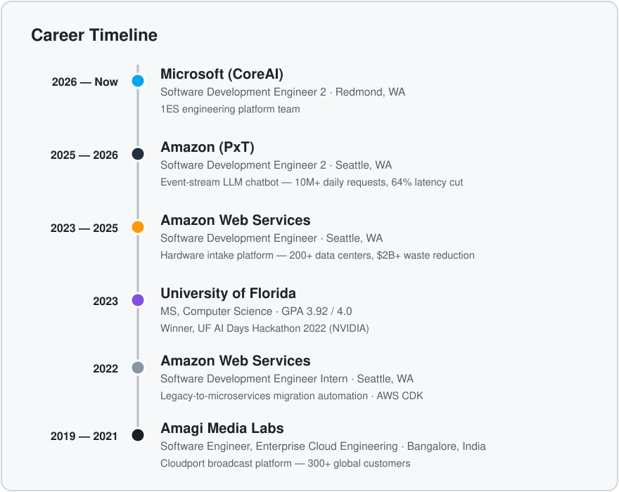

[LinkedIn](https://www.linkedin.com/in/girish-mallya-013345152/) · [Email](mailto:girishm60@gmail.com) · [Google Scholar](https://scholar.google.com/citations?user=Vjjz2ncAAAAJ&hl=en) · [📄 Resume](https://github.com/mallyagirish/mallyagirish/blob/master/resume/Girish_Mallya_Resume_2026.pdf)

## About

Software engineer with 6+ years across Microsoft, Amazon, and AWS, building distributed systems and cloud infrastructure at scale. Currently on Microsoft's 1ES engineering platform team. My research focuses on the reliability and security of cloud-native systems.

## 🗓️ Career Timeline

## 💼 Experience

###  Microsoft (CoreAI) — Redmond, WA
*Software Development Engineer 2 · May 2026 – Present*
- Software engineer on the 1ES engineering platform team.

###  Amazon (PxT) — Seattle, WA
*Software Development Engineer 2 · Mar 2025 – May 2026*
- Architected an event-stream–driven LLM chatbot (Bedrock, EventBridge, Lambda) that cut perceived latency by 64% and scaled to 10M+ daily requests across Amazon's corporate user base.
- Built the Release Notes platform used by 20+ partner teams — React frontend, service-backed APIs, headless-CMS authoring, automated translation into 32 languages, and semantic vector search.

###  Amazon Web Services — Seattle, WA
*Software Development Engineer · Jun 2023 – Mar 2025*
- Built backend services for a global hardware intake platform spanning 200+ AWS data centers, processing 500K+ hardware units quarterly.
- Delivered an optical-hardware fulfillment service optimizing routing and inventory placement — reducing annual hardware waste by $2B+, integrated with 10+ upstream/downstream systems.
- Created a synthetic-data test framework that cut CI/CD pipeline failures by 30%.
- *Intern, May–Jul 2022:* backend automation for migrating legacy customers to microservices; infrastructure as code with AWS CDK.

###  Amagi Media Labs — Bangalore, India
*Software Engineer, Enterprise Cloud Engineering · Jul 2019 – Aug 2021*
- Built distributed services for Cloudport, a cloud-native broadcast platform used by 300+ global customers.
- Designed a priority-based data purging algorithm that cut cloud storage costs by 60%; built a serverless media ingestion pipeline (Step Functions, Lambda, S3) generating $1.4M+ in annual revenue.

## 🔭 Research & Open Source

- 📊 **[Misconfigured by Default](https://github.com/mallyagirish/k8s-misconfig-study)** — empirical study of Kubernetes misconfigurations across 16,000+ manifests (151 Helm charts, 60 GitHub repos): prevalence of insecure defaults, and an audit of how well kube-linter, Checkov, Polaris, and kubeaudit actually catch them.
- 🛠️ Open PRs: new `no-image-digest` check for kube-linter ([#1281](https://github.com/stackrox/kube-linter/pull/1281)); new Secrets check CKV_K8S_161 for Checkov ([#7764](https://github.com/bridgecrewio/checkov/pull/7764)).

## 📝 Publications

- *Framework for Automatic Diagnosis of Psychological Disorders* — ICACCCN 2018 (IEEE)
- *Witty City — Smart City on an Intelligent Conway Grid* — ICCIS 2020 (Springer)

## 🛠️ Skills

| Area | Technologies |
| --- | --- |
| Languages | Python, Golang, Java, TypeScript, JavaScript, Kotlin |
| Cloud | AWS (Lambda, SQS, EC2, S3, API Gateway, CloudFormation), CDK, CircleCI |
| Data | MySQL, DynamoDB, Redis, Amazon RDS |
| Tools & Frameworks | Kubernetes, Docker, gRPC, React, Flask, Ruby on Rails, Git, CI/CD |

## 🏆 Achievements

- Winner, UF AI Days Hackathon 2022 (sponsored by NVIDIA) — most popular prize, top 1 of 200 entrants, for an NLP bot supporting sustainable development.

<b>🔎 Earlier project work</b>

 

**Concept Hierarchy Tree** — Python, Flask (2019)
- Designed a data structure that stores data hierarchically, ranking items in an abstract tree by similarity (Cosine Similarity, Jaccard Index).
- Built a recommendation system on top of it using data scraped from Amazon listings.

